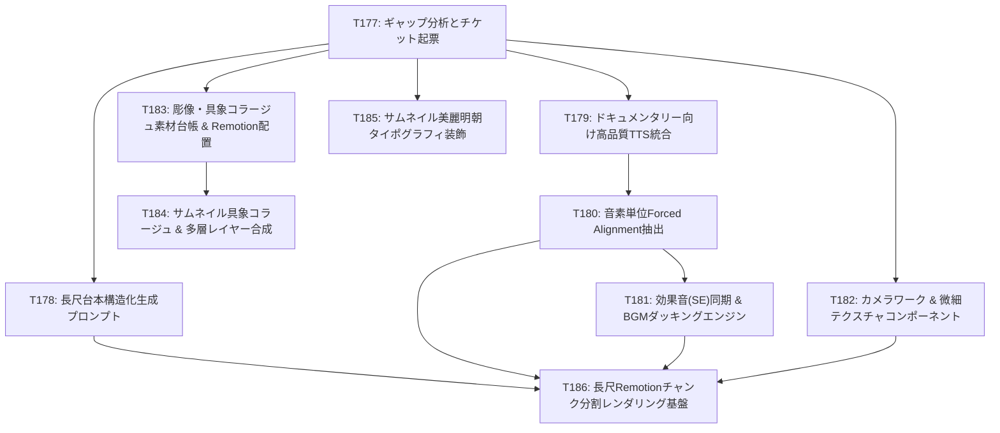

# 「考えすぎる葦」完全再現に向けた要件・ギャップ分析と開発課題

- 作成日: 2026-10-16
- 担当: Antigravity (Gemini 3.8 Flash (Medium))
- 関連チケット: [T177](file:///Users/hongj/Documents/Codex/2026-10-08/ai-api-1-youtube-1-10/tickets/T177.md)
- 対象チャンネル: [考えすぎる葦（@kangaesugiruashi）](https://www.youtube.com/@kangaesugiruashi)

---

## 1. 概要と目的

YouTubeチャンネル「考えすぎる葦」（[@kangaesugiruashi](https://www.youtube.com/@kangaesugiruashi)）は、日常の身近な疑問や不条理を、進化心理学・社会学・行動経済学・認知科学などの多角的な学術知見とダークテーマの洗練されたモーショングラフィックスで紐解く、極めて人気の高い知的好奇心探究型ドキュメンタリーチャンネルである。

本リポジトリは、日常の知識を深掘りするローカル動画制作基盤として、Plan v2、Remotion統合、CoreGraphicsサムネイル描画、事実・権利確認、ジョブキュー等の基盤を急速に整備してきた。しかし、「考えすぎる葦」と**全く同じクオリティ・視聴体験の動画およびサムネイル**を自動または人とAIの協働で制作するためには、依然として埋めるべき重要な機能ギャップ・表現力ギャップが存在する。

本ドキュメントでは、参考チャンネルの本質的要件と現在のリポジトリの実装状況を対比・精査し、不足要素を5大領域（企画・台本、音声・音響、映像演出・素材、サムネイル、長尺プロダクション）に分類して、実行可能な課題チケット（T178〜T186）として定義する。

---

## 2. 「考えすぎる葦」の動画・サムネイル本質要件

### 2.1 動画本編の要件
1. **動画尺・フォーマット**:
   - 通常尺: **10分〜20分程度**（平均15分前後、約18,000〜36,000フレーム）。
   - 解像度: 1920x1080 (16:9), 30fpsまたは60fps。
2. **ストーリー・台本構造（Narrative Architecture）**:
   - **「日常の素朴な疑問や違和感」×【二重の学術フック】**（例: 「なぜ2位ではダメなのか【スーパースター経済学】」「なぜ差別をなくすほど社会は分断されるのか【社会心理学】」）。
   - 逆説の提示（Paradox）→ 直感の解体（Deconstruction）→ 学術メカニズム解明（Theory & Mechanism）→ 現代社会への一般化（Generalization）→ **発信者本人の哲学的内省（Reflection）**→ 余韻の残る結び。
   - 実在の学術論文、心理学実験、統計データの厳格な引用と明示。
3. **音声・音響設計（Sound & Narration Design）**:
   - **低音・落ち着き・知性のある高品質ナレーション**: 機械的な平坦さや甲高いアニメ声ではなく、信頼感を与える落ち着いた男性・中性的なトーン。話速は約5.2〜5.8文字/秒、展開ごとの適切な「間（ポーズ 0.3〜0.6秒）」。
   - **アンビエント劇伴BGM & 自動ダッキング**: 思考を妨げないミニマル・ドローン調のBGMが背後で流れ、ナレーション発話区間では自動で音量が減衰（-18dB〜-20dB）する。
   - **ミリ秒単位の同期効果音（SE）**: 章題の提示、グラフの伸長、キーワードの出現、シーン転換に合わせた控えめで洗練された効果音（パルス音、スウィッシュ、ヒット音、ページめくり音）。
4. **映像・モーショングラフィックス（Visual & Motion Graphics）**:
   - **空間・テクスチャ**: 漆黒（`#0a0a0c`）や濃紺の暗黒空間、微小なフィルムノイズ・グレイン、ビネット効果、スポットライト照明。
   - **具象モチーフとコラージュ**: 抽象ピクトグラムだけでなく、彫像風・歴史的絵画・写真風のコラージュ、題材固有の具象イラスト（魚、牛、月、家系図、天秤、王冠、群衆など）。
   - **動的カメラワーク**: 静止スライド感を排除する緩やかなドリーズーム、パン、視差（パララックス効果）。
   - **物理的加減速（Bezier Easing）**: `cubic-bezier(0.16, 1, 0.3, 1)`（OutQuart）による滑らかな連続動作、要素の連鎖的出現（Staggered Animation）。
   - **視覚リズム**: 3〜5秒ごとに何らかの微小な視覚変化があり、15分間飽きさせない。
5. **字幕（テロップ）**:
   - 画面下中央、格調高い明朝体（または洗練された角ゴシック）、白文字＋微細シャドウまたは半透明帯。助詞・文節の自然な改行。

### 2.2 サムネイルの要件
1. **視覚的フック（Visual Hook）**:
   - 左右対比（勝者 vs 敗者、牛 vs 魚）、象徴的中心（巨大な月、王冠、家系図の収束、崩れる頭部など）の明確な構図。
   - 彫像風・写真風・コラージュ風の具象素材とライティング（スポットライト、グロー、影）。
2. **言語的フック（Verbal Hook / Typography）**:
   - 6〜8文字程度の巨大な主見出し＋補助見出し（「なぜ〜なのか」「〇〇の絶滅」「2位の生存戦略」）。
   - 美麗な明朝体・太ゴシック、漢字のサイズ強調、袋文字、微小なグラデーション。
3. **視認性・色彩**:
   - 黒背景を中心としつつ、生成り・明色背景も存在。題材に応じた鮮烈なアクセントカラー（赤・青・金）。
   - YouTubeのモバイル一覧や関連動画の極小表示（160x90）でも、一瞬で「何の疑問か」「何の対比か」が視認・認識できる。

---

## 3. 現行リポジトリの到達点と不足しているギャップ

| 領域 | 現行リポジトリの到達点 | 「考えすぎる葦」完全再現への不足要素（ギャップ） |
|---|---|---|
| **① 企画・台本** | Plan v2形式、本人の考察工程（produce）、エージェント下書きSkill（T123）。デモ用短尺（48〜68秒）。 | **10〜20分尺（5,000〜8,000字）の長尺台本を、二重学術フック・逆説・章立て・一次文献引用込みで自動構造化生成する仕組みが未確立**。 |
| **② 音声・音響** | macOS `say`（Kyoko等）による簡易実ナレーション（T170）、合成トーンによるダッキング実験（T138）。 | **ドキュメンタリー向けの低音・知性派高品質TTS（VOICEVOX等）、音素・単語単位の高精度アライメント（Forced Alignment）、演出と同期するSE（効果音）配置エンジンが未実装**。 |
| **③ 映像・モーション** | Remotion統合（T126）、scene archetype・人型イラスト（T145, T150）、枠なし字幕（T144）、文節改行（T174）。 | **具象コラージュ（彫像・絵画等）、カメラワーク（パン・ズーム・パララックス）、微細テクスチャ（グレイン・ビネット）、長尺視覚リズム制御（T157）が未実装**。 |
| **④ サムネイル** | 契約（T160）、3候補構成（T161）、専用CoreGraphics PNG描画（T163）、縮小視認性測定（T173）。 | **単色幾何学SVGの枠を出ておらず、具象コラージュ、多層レイヤー合成、ライティング効果（グロー・シャドウ）、美麗明朝体タイポグラフィ装飾が未実装**。 |
| **⑤ 長尺制作基盤** | 長尺ベンチマークスクリプト（T175）、永続ジョブキュー（T141, T172）。 | **10〜20分長尺Remotion描画のメモリクラッシュ対策（チャンク分割レンダリング・ffmpeg無劣化結合）と完全媒体検査パイプラインが未確立**。 |

---

## 4. 切り出した開発チケット一覧（T178〜T186）

上記ギャップを解消し、完全再現を達成するための9件のチケットを以下のように定義・起票する：

### チケット要約
1. **T178 (P1/M4)**: 「日常の疑問×二重学術フック」長尺台本（10〜20分/5000〜8000字）の構造化生成プロンプトと章立てパイプラインの整備
2. **T179 (P1/M4)**: ドキュメンタリー向け高品質ローカル/外部TTS音声合成プロバイダー（VOICEVOX等）の統合と音響品質評価
3. **T180 (P1/M4)**: ナレーション音声波形からの音素・単語単位アライメント（Forced Alignment）抽出とcue自動同期
4. **T181 (P1/M4)**: シーン転換・強調演出に同期する効果音（SE）配置およびBGM自動ダッキング音響エンジンの実装
5. **T182 (P1/M4)**: カメラワーク（スローパン・ズーム・パララックス）と微細テクスチャ（グレイン・ビネット）演出コンポーネントの実装
6. **T183 (P1/M4)**: 彫像・具象モチーフ・コラージュ風素材の安全なライセンス管理とRemotion動的配置機能の実装
7. **T184 (P1/M4)**: サムネイル専用の具象コラージュ・ライティング・多層レイヤー合成エンジンの実装
8. **T185 (P1/M4)**: サムネイル用明朝・太ゴシックフォントの美麗タイポグラフィと文字装飾（グロー・袋文字・階層配置）の拡充
9. **T186 (P1/M4)**: 10〜20分長尺Remotion動画のチャンク分割レンダリング・結合と安定性保証パイプラインの実装

---
